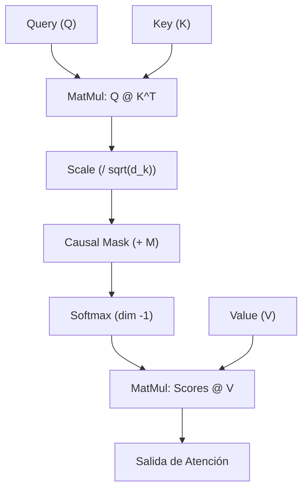

# Clase 05: Arquitectura Transformer y Memoria KV-Cache

Bienvenido a la **Clase 05 de la Fase 4 (IA & Machine Learning en Rust)**. En esta sesión estudiarás e implementarás el componente nuclear que gobierna a los modelos de lenguaje modernos (LLaMA 3, Mistral, Qwen 2.5, DeepSeek): **Multi-Head Attention (MHA)** y la técnica crítica de optimización en servidores de inferencia: el **KV-Cache (Key-Value Cache)**.

---

## 1. El Dilema de la Inferencia Autorregresiva

Los LLMs generan texto de forma **autorregresiva**: para producir el token $N+1$, la red neuronal necesita como contexto todos los tokens anteriores $[0, 1, \dots, N]$.

### Sin KV-Cache: La Ineficiencia $O(N^2)$
Si pasamos la secuencia completa en cada nuevo token:
- Token 1: Procesa 1 token.
- Token 2: Procesa 2 tokens (recalcula token 1).
- Token 3: Procesa 3 tokens (recalcula tokens 1 y 2).
- Token $N$: Procesa $N$ tokens.

$$\text{Cálculo total} \propto \sum_{i=1}^N i = \frac{N(N+1)}{2} = \mathcal{O}(N^2)$$

¡Estamos multiplicando matrices sobre los mismos tokens pasados una y otra vez!

### Con KV-Cache: Eficiencia $O(1)$ en Proyecciones
Las representaciones pasadas de las matrices $K$ (Keys) y $V$ (Values) **no cambian**. Por lo tanto, las guardamos en memoria RAM/VRAM en una estructura de datos persistente:
- **Fase Prefill (Prompt):** Se procesan todos los tokens de entrada de una sola vez ($L$ tokens). Se computan $Q, K, V$ y se llena el `KvCache` con longitud $L$.
- **Fase Decode (Generación):** Solo se envía **1 único token** a través de las capas lineales. Calculamos $q_{\text{nuevo}}, k_{\text{nuevo}}, v_{\text{nuevo}}$, concatenamos $k$ y $v$ al cache acumulado, y ejecutamos atención entre $q_{\text{nuevo}} \in \mathbb{R}^{1 \times D}$ y $K_{\text{cache}} \in \mathbb{R}^{(L+i) \times D}$.

$$\text{Proyección por token} = \mathcal{O}(1)$$

---

## 2. Scaled Dot-Product Attention

La fórmula canónica del mecanismo de atención:

$$\text{Attention}(Q, K, V) = \text{softmax}\left(\frac{Q K^T}{\sqrt{d_k}} + M\right) V$$

Donde:
* $Q \in \mathbb{R}^{B \times H \times S_q \times D_k}$: Query (lo que el token actual está buscando).
* $K \in \mathbb{R}^{B \times H \times S_k \times D_k}$: Key (la etiqueta identificativa de cada token en el contexto).
* $V \in \mathbb{R}^{B \times H \times S_k \times D_v}$: Value (el contenido semántico que se transmitirá).
* $\sqrt{d_k}$: Factor de escalamiento que evita que los productos punto crezcan excesivamente con dimensiones grandes (lo que provocaría gradientes saturados y softmax colapsado a un one-hot).
* $M$: Máscara Causal. En la fase de prefill, $M_{i, j} = -\infty$ cuando $j > i$ para evitar que tokens presentes "vean" tokens futuros. $\exp(-\infty) = 0$.



---

## 3. Rotary Position Embeddings (RoPE)

A diferencia de los Transformers originales (que sumaban vectores de posición absolutos $x + P$), arquitecturas modernas como LLaMA 3 y Mistral aplican rotaciones ortogonales a pares de coordenadas:

$$\begin{pmatrix} x'_{2i} \\ x'_{2i+1} \end{pmatrix} = \begin{pmatrix} \cos(m \theta_i) & -\sin(m \theta_i) \\ \sin(m \theta_i) & \cos(m \theta_i) \end{pmatrix} \begin{pmatrix} x_{2i} \\ x_{2i+1} \end{pmatrix}$$

Donde $\theta_i = \text{base}^{-2i/d}$ y $m$ es la posición del token. 
El producto escalar entre dos vectores rotados en posiciones $m$ y $n$ depende únicamente de la distancia relativa $(m - n)$:

$$\langle \text{RoPE}(q, m), \text{RoPE}(k, n) \rangle = g(q, k, m - n)$$

> [!IMPORTANT]
> **En KV-Cache:** Cuando generas el token $k$ en decode, debes rotar con `offset = cache.seq_len()`. Si pasas `offset = 0`, el token generado se comportará erróneamente como la primera palabra del prompt.

---

## 4. Estructura de la Clase

| Archivo | Propósito | Binario Cargo |
| :--- | :--- | :--- |
| [`01_teoria.rs`](file:///home/alcidesticlla/Documents/rust-ia/fase-4-ia-ml/clases/clase_05_transformer/01_teoria.rs) | Teoría profunda, matemáticas de RoPE, y simulación Prefill vs Decode con KV-Cache | `cargo run --bin c05_teoria` |
| [`02_errores_comunes.rs`](file:///home/alcidesticlla/Documents/rust-ia/fase-4-ia-ml/clases/clase_05_transformer/02_errores_comunes.rs) | Trampas fatales: shape mismatch en $QK^T$, concatenación en dimensión incorrecta, fugas causales | `cargo run --bin c05_errores` |
| [`03_ejercicios.rs`](file:///home/alcidesticlla/Documents/rust-ia/fase-4-ia-ml/clases/clase_05_transformer/03_ejercicios.rs) | Implementación modular de `MultiHeadAttention` y `KvCache` con 3 tests unitarios | `cargo test --bin c05_ejercicios` |

---

## 5. Ejecución y Validación

Para compilar y ejecutar los programas de la clase:

```bash
# Ejecutar la teoría interactiva
cargo run --bin c05_teoria

# Ejecutar el laboratorio de errores comunes
cargo run --bin c05_errores

# Ejecutar la demo práctica
cargo run --bin c05_ejercicios

# Ejecutar los 3 tests unitarios automatizados
cargo test --bin c05_ejercicios
```
