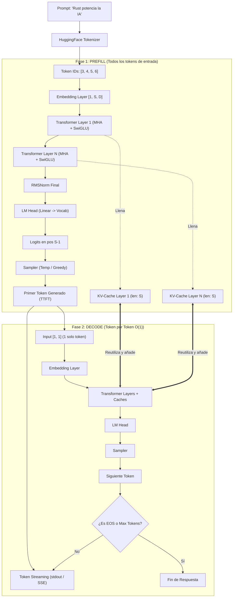

# Clase 06: Checkpoint Final — Servidor de Inferencia LLM con Token Streaming en Vivo

¡Bienvenido al **Checkpoint Final de la Fase 4 (IA & Machine Learning en Rust)**!

En este hito integrador has conectado de extremo a extremo **todas las tecnologías dominadas a lo largo de la fase**:
1. **Tokenización de Alto Rendimiento:** [`tokenizers`](file:///home/alcidesticlla/Documents/rust-ia/fase-4-ia-ml/clases/clase_03_tokenizers) de Hugging Face.
2. **Deep Learning Nativo:** [`candle_core`](file:///home/alcidesticlla/Documents/rust-ia/fase-4-ia-ml/clases/clase_04_candle) y [`candle_nn`](file:///home/alcidesticlla/Documents/rust-ia/fase-4-ia-ml/clases/clase_04_candle).
3. **Bloque Transformer Moderno:** Normalización [`RMSNorm`](file:///home/alcidesticlla/Documents/rust-ia/fase-4-ia-ml/clases/clase_04_candle/01_teoria.rs), activación no lineal [`SwiGLU`](file:///home/alcidesticlla/Documents/rust-ia/fase-4-ia-ml/clases/clase_04_candle/01_teoria.rs) y [`MultiHeadAttention`](file:///home/alcidesticlla/Documents/rust-ia/fase-4-ia-ml/clases/clase_05_transformer/03_ejercicios.rs).
4. **Optimización de Memoria:** [`KvCache`](file:///home/alcidesticlla/Documents/rust-ia/fase-4-ia-ml/clases/clase_05_transformer/03_ejercicios.rs) persistente por cada capa para decodificación $\mathcal{O}(1)$.
5. **Estrategia de Muestreo:** Sampler con Temperatura y Greedy Argmax determinista.
6. **Streaming de Tokens en Tiempo Real:** Emisión fluida token a token con vaciado de búfer (`io::stdout().flush()`).

---

## 1. Arquitectura de Inferencia de Extremo a Extremo



---

## 2. Las Dos Métricas Reinas del LLM Serving

En servidores de inferencia en producción (vLLM, Ollama, TensorRT-LLM, TGI), el rendimiento se mide mediante dos métricas fundamentales:

### A. TTFT (Time To First Token)
* **Definición:** El tiempo que transcurre desde que el usuario envía el prompt hasta que la primera palabra aparece en pantalla.
* **Componente que lo domina:** La **fase Prefill**. La GPU debe procesar todo el prompt y llenar el KV-Cache.
* **Optimización:** Prompt Caching, procesamiento paralelo de atención (`FlashAttention`).

### B. TPOT (Time Per Output Token)
* **Definición:** El tiempo promedio necesario para generar cada token subsiguiente durante la decodificación.
* **Componente que lo domina:** La **fase Decode**.
* **Cuello de botella:** **Ancho de banda de memoria (Memory Bandwidth)** de la GPU al leer los pesos y el KV-Cache.
* **Throughput:** $\frac{1000}{\text{TPOT}}$ tokens/segundo.

---

## 3. Estructura de la Clase

| Archivo | Propósito | Binario Cargo |
| :--- | :--- | :--- |
| [`01_teoria.rs`](file:///home/alcidesticlla/Documents/rust-ia/fase-4-ia-ml/clases/clase_06_checkpoint/01_teoria.rs) | Pipeline completo Prefill -> Decode con métricas TTFT/TPOT y visualización streaming en consola | `cargo run --bin c06_teoria` |
| [`02_errores_comunes.rs`](file:///home/alcidesticlla/Documents/rust-ia/fase-4-ia-ml/clases/clase_06_checkpoint/02_errores_comunes.rs) | Laboratorio de fallos de serving: buffering stall sin flush, inestabilidad con $T=0.0$, fugas de memoria y bucles infinitos | `cargo run --bin c06_errores` |
| [`03_ejercicios.rs`](file:///home/alcidesticlla/Documents/rust-ia/fase-4-ia-ml/clases/clase_06_checkpoint/03_ejercicios.rs) | Motor modular `InferenceEngine` con callback streaming y 3 tests unitarios | `cargo test --bin c06_ejercicios` |

---

## 4. Comandos de Ejecución y Validación

```bash
# Entrar al workspace de la Fase 4
cd /home/alcidesticlla/Documents/rust-ia/fase-4-ia-ml

# Ejecutar el servidor con streaming en vivo y reporte de métricas
cargo run --bin c06_teoria

# Ejecutar el laboratorio de errores comunes
cargo run --bin c06_errores

# Ejecutar la demo del motor modular
cargo run --bin c06_ejercicios

# Ejecutar los 3 tests unitarios del checkpoint
cargo test --bin c06_ejercicios

# Ejecutar la suite completa de la Fase 4 (18/18 tests pasando)
cargo test
```
