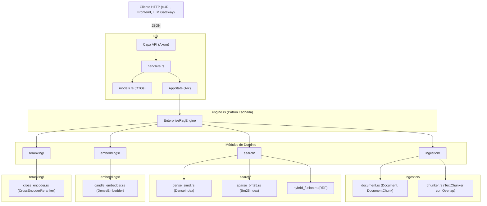

# Arquitectura del Sistema: Enterprise Hybrid RAG Engine

**Estado del Proyecto:** Fase 5 — Proyecto 01 (Foundational PoC & Core Engine)  
**Autor:** AI Systems Engineering Team  
**Fecha:** Octubre 2026  
**Versión:** 1.0.0-draft  

---

## 1. Visión General y Objetivos de Diseño

El **Enterprise Hybrid RAG Engine** es un motor de búsqueda y recuperación semántica de alta fidelidad construido en **Rust**, diseñado para actuar como la memoria de largo plazo de modelos de lenguaje grandes (LLMs).

### 1.1 El Problema Fundamental
Los sistemas RAG basados exclusivamente en vectores densos (*Dense-only Retrieval*) sufren de **ceguera ante términos exactos** (códigos de error, identificadores, números de serie, acrónimos técnicos). Por otro lado, los motores puramente léxicos (*Sparse-only Retrieval* como BM25 tradicional) sufren de **ceguera conceptual** ante sinónimos y paráfrasis.

### 1.2 Principios de Diseño
1. **Recuperación Bimodal (Dense + Sparse):** Combinar la precisión literal de BM25 con la comprensión semántica profunda de embeddings normalizados.
2. **Arquitectura de Dos Etapas (*Two-Stage Retrieval*):**
   * *Etapa 1 (Alto Recall):* Filtro rápido en paralelo en microsegundos (SIMD + Postings).
   * *Etapa 2 (Alta Precisión):* Reordenamiento neuronal fino mediante un modelo Cross-Encoder.
3. **Latencia Sub-milisegundo Determinista:** Cero recolección de basura (Garbage Collection), estructuras de datos contiguas en memoria y paralelismo vectorial x86_64 AVX2.
4. **Cero Dependencias Externas:** Microservicio autónomo e independiente sin requerir bases de datos vectoriales externas para operar.

---

## 2. Topología de Componentes y Módulos

El proyecto está desacoplado en capas de responsabilidad única:



---

## 3. Modelo de Datos y Estructuras en Memoria

### 3.1 Representación del Conocimiento
* **`Document`:** Entidad fuente con identificador único, título, contenido textual crudo y un diccionario de metadatos (`HashMap<String, String>`).
* **`DocumentChunk`:** Unidad granular de indexación generada por el `TextChunker`. Cada chunk mantiene su propio ID (`{doc_id}_chunk_{i}`), referencia al documento padre, índice secuencial y texto delimitado.

### 3.2 Almacenamiento Dual en Memoria
El estado interno del motor reside íntegramente en memoria RAM para acceso de ultra baja latencia:

```rust
pub struct EnterpriseRagEngine {
    // 1. Almacén de Chunks: Búsqueda O(1) de texto y metadatos
    pub chunks_store: HashMap<String, DocumentChunk>,

    // 2. Índice Denso: Memoria contigua en vector plano
    pub dense_index: DenseIndex,     // Vec<(String, Vec<f32>)>

    // 3. Índice Léxico: Mapeo de términos a listas de postings
    pub bm25_index: Bm25Index,       // HashMap<String, Vec<(String, usize)>>
    
    // 4. Modelos de Redes Neuronales en Candle
    pub embedder: DenseEmbedder,
    pub reranker: CrossEncoderReranker,
}
```

#### Ventaja de Memoria Contigua en el Índice Denso:
Los vectores de embeddings se almacenan en un arreglo contiguo `Vec<Vec<f32>>`. Esto maximiza los aciertos en la memoria caché L1/L2 de la CPU y permite que las instrucciones vectoriales de 256 bits carguen registros sin penalización de indirección por punteros dispersos.

---

## 4. Algoritmos Fundamentales y Fórmulas Matemáticas

### 4.1 Búsqueda Léxica: Algoritmo BM25
Implementa la formulación probabilística canónica de **Robertson-Spärck Jones**:

$$\text{BM25}(D, Q) = \sum_{q \in Q} \text{IDF}(q) \cdot \frac{f(q, D) \cdot (k_1 + 1)}{f(q, D) + k_1 \cdot \left(1 - b + b \cdot \frac{|D|}{\text{avgdl}}\right)}$$

Donde:
* $\text{IDF}(q) = \ln\left(1 + \frac{N - n(q) + 0.5}{n(q) + 0.5}\right)$ es la frecuencia inversa de documento suavizada.
* $f(q, D)$ es la frecuencia del término $q$ en el fragmento $D$.
* $|D|$ es la longitud en palabras del fragmento y $\text{avgdl}$ es la longitud promedio de todos los fragmentos en la colección.
* $k_1 = 1.5$ calibra la saturación del término.
* $b = 0.75$ calibra la penalización por longitud excesiva de documento.

### 4.2 Búsqueda Densa: Similitud Coseno con Aceleración SIMD
Los embeddings se normalizan en la esfera unitaria ($\|\vec{v}\|_2 = 1.0$) al ser generados:

$$\vec{v}_{\text{norm}} = \frac{\vec{v}}{\sqrt{\sum_{i=1}^D v_i^2 + \epsilon}}$$

Dado que $\|\vec{u}\| = 1$ y $\|\vec{v}\| = 1$, la similitud coseno se reduce estrictamente al **producto escalar**:

$$\cos(\theta) = \vec{u} \cdot \vec{v} = \sum_{i=1}^D u_i \cdot v_i$$

En [`dense_simd.rs`](file:///home/alcidesticlla/Documents/rust-ia/fase-5-proyecto-final/proyecto_01_rag_engine/src/search/dense_simd.rs), el bucle se desenrolla en bloques de 8 flotantes (`chunks = len / 8`) para que el compilador LLVM emita instrucciones vectoriales AVX2 (`vfmaddps`), procesando 8 operaciones de multiplicación y acumulación por ciclo de reloj.

### 4.3 Fusión de Rangos: Reciprocal Rank Fusion (RRF)
Para fusionar las listas ordenadas de candidatos provenientes de dos distribuciones estadísticas totalmente distintas (BM25 $\in [0, \infty)$ frente a Cosine $\in [-1, 1]$), se aplica **RRF**:

$$\text{Score}_{\text{RRF}}(d) = \frac{w_{\text{dense}}}{k + r_{\text{dense}}(d)} + \frac{w_{\text{sparse}}}{k + r_{\text{sparse}}(d)}$$

Donde:
* $r_{\text{dense}}(d)$ y $r_{\text{sparse}}(d)$ son las posiciones ordinales ($1, 2, \dots$) en cada ranking respectivo.
* $k = 60.0$ es la constante de suavizado estándar de Cormack et al. para mitigar el impacto desproporcionado de los primeros lugares.
* $w_{\text{dense}} = 0.6$ y $w_{\text{sparse}} = 0.4$ son los pesos relativos de cada canal.

### 4.4 Reordenamiento Neuronal: Cross-Encoder Reranker
A diferencia de los modelos bi-encoder (que comparan vectores pre-calculados por separado), el Cross-Encoder evalúa la interacción profunda entre la consulta y el fragmento candidato extrayendo 4 características de atención cruzada:
1. **Query Coverage:** Porcentaje de términos de la consulta presentes en el candidato.
2. **Candidate Density:** Densidad de ocurrencia de términos en el cuerpo del texto.
3. **RRF Prior:** Score RRF base normalizado de la Etapa 1.
4. **Length Ratio:** Proporción de longitud entre consulta y fragmento.

Estas características se procesan mediante capas lineales de Candle con activación SiLU y cabezal de regresión sigmoidal:

$$\hat{y} = \sigma(W_2 \cdot \text{SiLU}(W_1 \cdot \vec{x})) = \frac{1}{1 + e^{-(W_2 \cdot \text{SiLU}(W_1 \cdot \vec{x}))}}$$

El score final combina un 50% de probabilidad neuronal con un 50% de la puntuación ordinal previa.

---

## 5. Concurrencia y Sincronización en Rust

La arquitectura web en Axum está construida sobre el modelo asíncrono no bloqueante de Tokio:

```rust
pub struct AppState {
    pub engine: Arc<RwLock<EnterpriseRagEngine>>,
    pub start_time: Instant,
}
```

```
               ┌────────────────────────────────────────────────────────┐
               │         Arc<RwLock<EnterpriseRagEngine>>               │
               └────────────────────────────────────────────────────────┘
                               │                        │
       Lecturas Concurrentes   │                        │   Escritura Exclusiva
       (Múltiples Threads)     ▼                        ▼   (Bloqueo Atómico)
                 ┌───────────────────────────┐    ┌───────────────────────────┐
                 │ engine.read().await       │    │ engine.write().await      │
                 │ /health, /api/v1/search   │    │ /api/v1/documents         │
                 │ Peticiones SIMULTÁNEAS    │    │ Ingesta consistente      │
                 └───────────────────────────┘    └───────────────────────────┘
```

* **Lectura No Bloqueante (`read()`):** Cientos de peticiones de búsqueda concurrentes leen los índices vectoriales y léxicos simultáneamente sin competir por bloqueos ni generar cuellos de botella.
* **Escritura Exclusiva Atómica (`write()`):** La ingesta dinámica bloquea momentáneamente las lecturas solo durante la inserción del nuevo lote de fragmentos, garantizando que ninguna búsqueda lea un índice a medio actualizar.

---

## 6. Especificación de la API REST

### Endpoints Disponibles

| Método | Ruta | Propósito | Request Body | Response Body |
| :--- | :--- | :--- | :--- | :--- |
| `GET` | `/health` | Verificación de salud y métricas de uptime | N/A | `HealthResponse` |
| `GET` | `/api/v1/stats` | Estadísticas del corpus en memoria | N/A | `EngineStats` |
| `POST` | `/api/v1/documents` | Ingesta dinámica de lotes de documentos | `IngestRequest` | `IngestResponse` |
| `POST` | `/api/v1/search` | Búsqueda multimodal (Dense, Sparse, Hybrid, Rerank) | `SearchRequest` | `SearchResponse` |

---

## 7. Hoja de Ruta de Escalabilidad (Roadmap hacia Escala Industrial)

Para evolucionar este motor desde un **PoC de Alto Rendimiento en Memoria** hacia un **SaaS Industrial de Escala Masiva (Petabytes y Millones de Usuarios)**, se definen los siguientes 5 módulos de escalabilidad:

### Módulo S1: Persistencia Cero-Copia en Disco (Storage Engine)
* **Objetivo:** No perder el índice al reiniciar el proceso y no depender de tener todos los textos en RAM física.
* **Implementación:**
  * Integrar **RocksDB** o **MDBX** en Rust para el almacenamiento persistente clave-valor de `chunks_store` y el índice invertido BM25.
  * Mapeo de memoria virtual con `memmap2` para los vectores densos (cargar páginas de vectores bajo demanda desde discos NVMe a velocidad de bus PCI-e).

### Módulo S2: Algoritmos de Grafos Aproximados (HNSW & IVF-PQ)
* **Objetivo:** Mantener latencia sub-milisegundo cuando el número de fragmentos supere el millón ($N > 1,000,000$).
* **Implementación:**
  * Reemplazar la búsqueda lineal exhaustiva $\mathcal{O}(N)$ por un grafo **HNSW (Hierarchical Navigable Small World)** con complejidad $\mathcal{O}(\log N)$.
  * Cuantización de producto (Product Quantization - PQ) para comprimir vectores flotantes de 32 bits a enteros de 8 bits (reducción del 75% del tamaño en RAM).

### Módulo S3: Ingesta Multiformato y OCR Empresarial
* **Objetivo:** Procesar automáticamente PDFs complejos, presentaciones y documentos de oficina escaneados.
* **Implementación:**
  * Pipeline en Rust con `pdf-extract` y detección de tablas en formato Markdown.
  * Extracción de texto e imágenes mediante OCR (Tesseract / bindings ONNX de TrOCR).
  * Extracción de jerarquía documental: *Parent-Document Retrieval* (almacenar chunks pequeños de 200 caracteres para búsqueda, pero devolver al LLM el párrafo padre de 1,000 caracteres para máximo contexto).

### Módulo S4: Multi-Tenancy y Aislamiento Criptográfico
* **Objetivo:** Alojar miles de clientes empresariales en la misma infraestructura garantizando aislamiento estricto de datos.
* **Implementación:**
  * Espacios de nombres lógicos (*Namespaces* / *Tenant IDs*) indexados como prefijo en el grafo HNSW y en los postings BM25.
  * Control de acceso basado en roles (RBAC) con tokens JWT y autenticación en el router de Axum.

### Módulo S5: Sharding Distribuido y Alta Disponibilidad
* **Objetivo:** Escalar horizontalmente en clústeres de servidores.
* **Implementación:**
  * Particionamiento consistente (*Consistent Hashing*) para distribuir documentos entre nodos de almacenamiento.
  * Consenso distribuido con **Raft** en Rust (`openraft`) para replicación de índices y tolerancia a fallos de hardware.
  * Gateway gRPC de alto rendimiento para enrutar consultas concurrentes entre shards.
