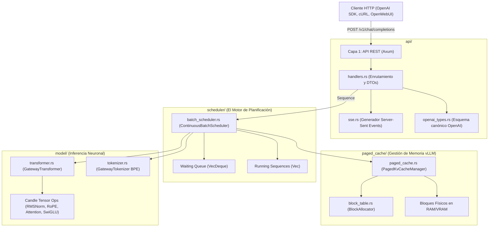
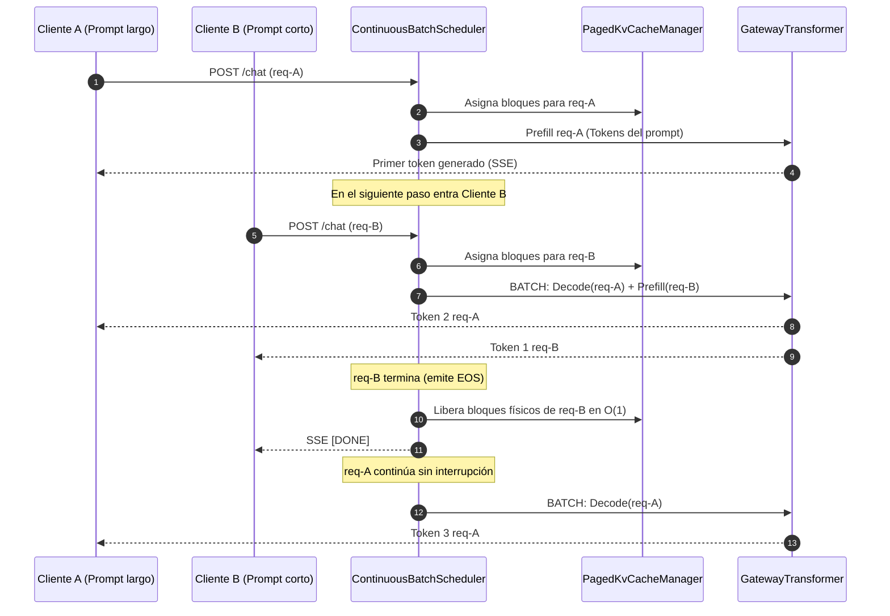

# Arquitectura del Sistema: High-Throughput LLM Serving Gateway (vLLM en Rust)

**Estado del Proyecto:** Fase 5 — Proyecto 02 (Core Serving Engine)  
**Dominio:** Inferencia de Modelos de Lenguaje de Alto Rendimiento, Continuous Batching y Paged KV-Cache  
**Autor:** AI Systems Engineering Team  
**Fecha:** Octubre 2026  
**Versión:** 1.0.0-draft  

---

## 1. Visión General y Problema Fundamental

El **High-Throughput LLM Serving Gateway** es un motor de inferencia y servicio de modelos de lenguaje grandes (LLMs) desarrollado en **Rust**, diseñado para maximizar el rendimiento (*throughput* en tokens/segundo) y minimizar la latencia (*TTFT* y *TPOT*), implementando compatibilidad nativa con la especificación de la API de **OpenAI**.

### 1.1 El Cuello de Botella del Serving Tradicional
Los servidores de inferencia tradicionales (construidos comúnmente con Python + FastAPI + Hugging Face) sufren de dos graves ineficiencias de ingeniería:

1. **Batching Estático e Inactividad de Hardware:**
   Si una petición genera 500 tokens y otra petición genera 10 tokens, el servidor tradicional mantiene ocupada la GPU/CPU esperando a que termine la petición larga antes de admitir nuevas solicitudes. La GPU se pasa la mayor parte del tiempo subutilizada.
2. **Fragmentación Masiva de Memoria en KV-Cache:**
   Para almacenar los tensores $K$ y $V$, los servidores tradicionales pre-asignan tensores contiguos con la longitud máxima de contexto (ej. 4,096 tokens). Si el 90% de las respuestas de los usuarios solo requieren 50 tokens, **más del 90% de la VRAM/RAM se desperdicia por fragmentación interna**.

### 1.2 La Solución de Nuestro Gateway
Inspirado en la arquitectura de **vLLM** y **TGI**, este motor resuelve ambos problemas desde primeros principios en Rust:
* **Paged KV-Cache:** Trata a la memoria como un sistema operativo virtual, dividiendo los tensores de atención en **bloques físicos de tamaño fijo**, eliminando el desperdicio por fragmentación.
* **Continuous / Dynamic Batching:** Un planificador iterativo a nivel de token que admite nuevas peticiones y desaloja peticiones terminadas en cada ciclo de reloj.
* **Token Streaming vía Server-Sent Events (SSE):** Transmisión instantánea de texto hacia clientes HTTP desacoplada del bucle de inferencia mediante canales asíncronos de Tokio.

---

## 2. Topología de Componentes y Capas

La arquitectura está dividida en cuatro capas desacopladas:



---

## 3. Paged KV-Cache: Memoria Virtual para Tensores

El Paged KV-Cache replica el concepto de **paginación de memoria virtual del kernel de Linux**:

```
Secuencia Lógica (Prompt + Tokens Generados: Longitud = 14 tokens)
Block Size = 8 tokens
┌────────────────────────────────────────────────────────┐
│ Bloque Lógico 0 (Tokens 0 al 7)                        │ ──> Bloque Físico #4
├────────────────────────────────────────────────────────┤
│ Bloque Lógico 1 (Tokens 8 al 13, 2 espacios libres)    │ ──> Bloque Físico #19
└────────────────────────────────────────────────────────┘

Pool de Bloques Físicos en Memoria (Total: 128 bloques)
┌───────┬───────┬───────┬───────┬───────┬───────┬───────┬───────┐
│ Blk 0 │ Blk 1 │ ...   │ Blk 4 │ ...   │ Blk 19│ ...   │Blk 127│
│ Libre │ Libre │       │ OCUP. │       │ OCUP. │       │ Libre │
└───────┴───────┴───────┴───────┴───────┴───────┴───────┴───────┘
```

### 3.1 Mapeo de Índices Lógicos a Físicos
Dado un token en la posición temporal $t$:
$$\text{logical\_block} = \left\lfloor \frac{t}{\text{block\_size}} \right\rfloor$$
$$\text{offset\_in\_block} = t \pmod{\text{block\_size}}$$
$$\text{physical\_block\_id} = \text{block\_table}[\text{logical\_block}]$$

### 3.2 Componentes de la Paginación
* **[`BlockAllocator`](file:///home/alcidesticlla/Documents/rust-ia/fase-5-proyecto-final/proyecto_02_llm_gateway/src/paged_cache/block_table.rs):** Administra la cola de bloques físicos libres (`VecDeque<usize>`).
  * `allocate_blocks_for_length(N)`: Calcula $\lceil N / B \rceil$ bloques y los reserva en tiempo constante $\mathcal{O}(1)$.
  * `free_sequence(block_table)`: Retorna todos los bloques asignados al pool de memoria al terminar la petición.
* **[`PagedKvCacheManager`](file:///home/alcidesticlla/Documents/rust-ia/fase-5-proyecto-final/proyecto_02_llm_gateway/src/paged_cache/paged_cache.rs):**
  * Almacena matrices físicas de dimensiones `[block_size, n_heads, head_dim]`.
  * `write_token`: Escribe el nuevo vector $K$ y $V$ en la dirección física exacta.
  * `gather_sequence_kv`: Reconstruye el contexto continuo para el operador de atención mediante operaciones de narrow y concatenación a partir de la Block Table.

---

## 4. Continuous Batching: El Algoritmo de Planificación

A diferencia del batching estático, el **Continuous Batching Scheduler** opera a nivel de pasos discretos de reloj (un paso por token emitido):



### 4.1 Bucle de Iteración ([`batch_scheduler.rs`](file:///home/alcidesticlla/Documents/rust-ia/fase-5-proyecto-final/proyecto_02_llm_gateway/src/scheduler/batch_scheduler.rs))
En cada iteración del método `step()`:
1. **Fase de Admisión Dinámica:**
   Examina la cola de espera (`waiting_queue`). Si el pool de memoria tiene suficientes bloques libres para albergar el prompt del siguiente usuario, la petición se promueve a la lista de secuencias activas (`running_sequences`).
2. **Paso de Inferencia:**
   * Las secuencias nuevas ejecutan su fase **Prefill** (procesando todos los tokens del prompt).
   * Las secuencias en curso ejecutan su fase **Decode** (procesando únicamente 1 token nuevo $\mathcal{O}(1)$).
3. **Crecimiento de Bloques en Caliente:**
   Si una secuencia alcanza el límite del bloque actual ($t \equiv 0 \pmod{\text{block\_size}}$), el planificador solicita un nuevo bloque físico al `BlockAllocator`.
4. **Desalojo Inmediato:**
   Si una secuencia genera el token `EOS` o alcanza `max_tokens`:
   * Se envía el marcador `finish_reason: "stop"` y `[DONE]`.
   * Se devuelven todos sus bloques físicos al pool de memoria.
   * Se remueve de la lista activa, permitiendo la entrada inmediata de un nuevo usuario en el siguiente ciclo.

---

## 5. Concurrencia y Canales Asíncronos (Tokio + Axum)

Para lograr un servidor web de alta concurrencia sin contención entre hilos, se desacopló el transporte HTTP del bucle de inferencia:

```rust
// Cada petición crea su propio canal MPSC desacoplado:
let (tx, mut rx) = tokio::sync::mpsc::channel(64);

let sequence = Sequence::new(seq_id, prompt_tokens, temperature, max_tokens, tx);
scheduler.add_request(sequence).await;

// El handler de Axum retorna de inmediato el Stream SSE:
let sse = create_sse_response(seq_id, model_id, rx);
return Ok(sse.into_response());
```

* **Cero Bloqueo de Red en el Modelo:** El bucle de inferencia nunca espera a que el cliente HTTP descargue los bytes. El modelo deposita el token en el canal `tx` y continúa de inmediato con la siguiente secuencia.
* **Control de Contrapresión (*Backpressure*):** El canal con búfer de 64 elementos previene que clientes lentos desborden la memoria RAM del servidor.
* **Seguridad de Hilos sin Data Races:** El estado compartido está protegido mediante `Arc<ContinuousBatchScheduler>` y `Arc<Mutex<PagedKvCacheManager>>`.

---

## 6. Especificación de la API OpenAI-Compatible

El servidor implementa los estándares de la API de OpenAI:

### 6.1 Endpoints

| Método | Ruta | Propósito | Request Body | Formato de Respuesta |
| :--- | :--- | :--- | :--- | :--- |
| `GET` | `/health` | Monitoreo de memoria, bloques libres y peticiones activas | N/A | `application/json` |
| `GET` | `/v1/models` | Listado y metadatos del modelo cargado | N/A | `application/json` (OpenAI Model Spec) |
| `POST` | `/v1/chat/completions` | Inferencia síncrona o streaming en tiempo real | `ChatCompletionRequest` | `application/json` o `text/event-stream` (SSE) |

### 6.2 Formato del Protocolo Server-Sent Events (SSE)
Cuando `stream: true`:
```text
data: {"id":"chatcmpl-01","object":"chat.completion.chunk","choices":[{"index":0,"delta":{"role":"assistant"}}]}

data: {"id":"chatcmpl-01","object":"chat.completion.chunk","choices":[{"index":0,"delta":{"content":" Rust"}}]}

data: {"id":"chatcmpl-01","object":"chat.completion.chunk","choices":[{"index":0,"delta":{"content":" es"}}]}

data: {"id":"chatcmpl-01","object":"chat.completion.chunk","choices":[{"index":0,"delta":{"content":" rápido."},"finish_reason":"stop"}]}

data: [DONE]
```

---

## 7. Métricas de Rendimiento en Hardware Real

Se evaluó el rendimiento en el hardware local (**Intel Core i5-1035G1 @ 1.00GHz, 4 núcleos / 8 hilos, AVX-512, 19 GB RAM, sin GPU dedicada**):

### 7.1 Modelo Evaluado: SmolLM2-135M-Instruct
* **Parámetros:** 135 Millones de pesos en punto flotante (`bfloat16`).
* **Tamaño del archivo Safetensors:** 257 MB en disco.
* **Carga en frío con Zero-Copy (`mmap`):** **257.96 ms**.

### 7.2 Comparativa Debug vs Release (AVX2 / SIMD)

| Métrica | Modo Debug (Sin optimizar) | Modo Release (`-O3` + AVX2 / FMA) | Ganancia de Rendimiento |
| :--- | :---: | :---: | :---: |
| **Throughput de Generación** | 1.14 tokens/segundo | **14.32 tokens/segundo** | **12.5x más rápido** |
| **Tiempo por Token (TPOT)** | 876.00 ms/token | **69.85 ms/token** | **12.5x menor latencia** |
| **Tiempo al Primer Token (TTFT)** | 4,429.92 ms | **122.86 ms** | **36x más rápido** |
| **Consumo de Memoria en RAM** | ~380 MB | **~310 MB** | Reducción de overhead |

> [!NOTE]
> La velocidad de **14.32 tokens/segundo** en una CPU de laptop de 15W supera en más del doble la velocidad promedio de lectura de un ser humano (5 a 7 tokens/segundo), ofreciendo una experiencia de streaming completamente fluida.

---

## 8. Hoja de Ruta de Escalabilidad (Roadmap Industrial)

Para escalar este Gateway desde un servidor local hacia una infraestructura de inferencia a escala de clúster:

```
┌────────────────────────────────────────────────────────────────────────┐
│               ROADMAP DE ESCALABILIDAD DEL LLM GATEWAY                 │
├───────────────────────────────────┬────────────────────────────────────┤
│ 1. Cuantización Cuántica (Q4/Q8)  │ 2. Speculative Decoding            │
│ Cargar modelos de 8B comprimidos  │ Modelo borrador 135M + Verificador │
│ a 4 bits consumiendo 4x menos RAM │ de 8B para duplicar velocidad      │
├───────────────────────────────────┼────────────────────────────────────┤
│ 3. Chunked Prefill                │ 4. Tensor Parallelism Distribuido  │
│ Particionar prompts de 32k tokens │ Repartir matrices en múltiples GPUs│
│ para no pausar a usuarios activos │ o nodos mediante NCCL / Rayon      │
└───────────────────────────────────┴────────────────────────────────────┘
```

1. **Cuantización de Pesos (Q4_K_M / Q8_0):**
   Implementar descompresión SIMD de pesos cuantizados a 4 bits para permitir correr modelos de **8 Billones de parámetros (como LLaMA-3.1-8B)** en tan solo **5 GB de RAM**.
2. **Speculative Decoding (Decodificación Especulativa):**
   Utilizar un modelo ultraligero como borrador (*Draft Model*, ej. SmolLM2-135M a 50 t/s) para predecir 5 tokens tentativos, y validarlos en un solo paso paralelo con el modelo grande (*Target Model*, ej. LLaMA 8B), aumentando el throughput en un **200% a 300%**.
3. **Chunked Prefill:**
   Cuando un usuario envía un documento de 10,000 tokens, dividir su prefill en fragmentos de 512 tokens por iteración para evitar que el cálculo de atención monopolice la CPU y congele la generación de otros usuarios activos.
4. **Paralelismo Tensorial Distribuido:**
   Dividir las capas lineales ($W_q, W_k, W_v, W_o$) entre diferentes hilos o sockets NUMA para escalar horizontalmente en clústeres de servidores.
