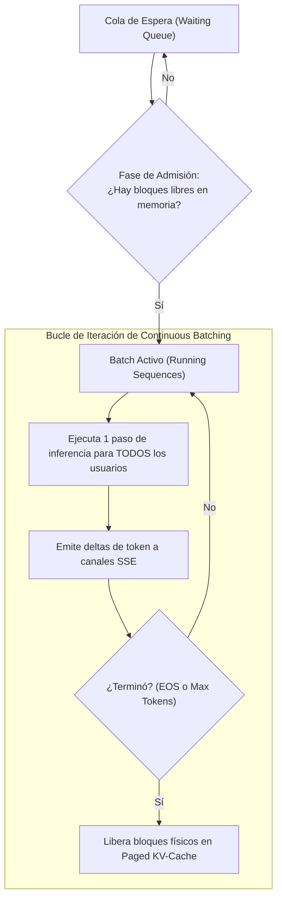

# Proyecto 02: High-Throughput LLM Serving Gateway (vLLM en Rust)

Gateway de Inferencia de Modelos de Lenguaje de Alto Rendimiento compatible con la especificación de OpenAI (`/v1/chat/completions`), implementado en **Rust** con **Continuous Batching**, **Paged KV-Cache** y **Token Streaming vía Server-Sent Events (SSE)**.

---

## 1. La Arquitectura de Inferencia Moderna: ¿Por qué vLLM?

Los servidores de inferencia tradicionales (como FastAPI con Hugging Face) sufren de dos ineficiencias críticas que limitan el throughput:

### A. El Problema del Batching Estático frente a Continuous Batching
* **Batching Estático:** Si el usuario A pide 300 tokens y el usuario B pide 10 tokens, el usuario B termina en 10 pasos, pero la GPU/CPU se queda ociosa esperando a que el usuario A termine los 300 pasos antes de admitir cualquier nueva petición.
* **Continuous Batching (Nuestro Motor):** Las peticiones se gestionan a nivel de **iteración individual**. Si el usuario B termina en el paso 10, es retirado inmediatamente y una nueva petición C de la cola de espera se incorpora al batch en el paso 11 sin interrumpir al usuario A.



---

## 2. El Paged KV-Cache: Memoria Virtual para Tensores

En un servidor LLM estándar, el KV-Cache se asigna como un tensor contiguo gigante con la longitud máxima de contexto (ej. 4,096 tokens). Si la mayoría de las respuestas solo usan 50 tokens, **más del 95% de la VRAM se desperdicia por fragmentación interna**.

### Nuestra Implementación Paged KV-Cache ([`paged_cache/`](file:///home/alcidesticlla/Documents/rust-ia/fase-5-proyecto-final/proyecto_02_llm_gateway/src/paged_cache)):
1. **Bloques Físicos:** La memoria se divide en bloques pequeños de tamaño fijo (ej. 8 o 16 tokens por bloque).
2. **Asignador de Bloques ([`block_table.rs`](file:///home/alcidesticlla/Documents/rust-ia/fase-5-proyecto-final/proyecto_02_llm_gateway/src/paged_cache/block_table.rs)):** Administra un pool de bloques libres (`VecDeque<usize>`).
3. **Tabla de Bloques Lógica a Física:** Cada secuencia mantiene su propia lista de bloques asignados (`block_table: Vec<usize>`).
4. **Crecimiento Dinámico:** Una secuencia solo pide un nuevo bloque físico cuando el actual se llena.
5. **Cero Desperdicio:** Al terminar la secuencia, sus bloques físicos se devuelven al pool en $\mathcal{O}(1)$.

---

## 3. Especificación de la API (Compatible con OpenAI)

El servidor implementa los estándares de la API de OpenAI, permitiendo que librerías como el SDK oficial de OpenAI en Python, TypeScript o herramientas como OpenWebUI se conecten de forma transparente.

### A. Streaming de Tokens en Vivo con Server-Sent Events (SSE)
* **Ruta:** `POST /v1/chat/completions`
* **Petición con cURL:**
```bash
curl -N -X POST http://localhost:8000/v1/chat/completions \
  -H "Content-Type: application/json" \
  -d '{
    "model": "rust-vllm-mini",
    "messages": [
      {"role": "user", "content": "Hola"}
    ],
    "temperature": 0.7,
    "max_tokens": 15,
    "stream": true
  }'
```
* **Respuesta SSE transmitida en tiempo real:**
```text
data: {"id":"chatcmpl-123","object":"chat.completion.chunk","choices":[{"index":0,"delta":{"role":"assistant"}}]}

data: {"id":"chatcmpl-123","object":"chat.completion.chunk","choices":[{"index":0,"delta":{"content":" El"}}]}

data: {"id":"chatcmpl-123","object":"chat.completion.chunk","choices":[{"index":0,"delta":{"content":" futuro"}}]}

data: {"id":"chatcmpl-123","object":"chat.completion.chunk","choices":[{"index":0,"delta":{"content":" de"}}]}

data: [DONE]
```

### B. Inferencia Síncrona No-Streaming
* **Petición con cURL:**
```bash
curl -X POST http://localhost:8000/v1/chat/completions \
  -H "Content-Type: application/json" \
  -d '{
    "model": "rust-vllm-mini",
    "messages": [
      {"role": "user", "content": "Hola"}
    ],
    "stream": false
  }'
```
* **Respuesta JSON:**
```json
{
  "id": "chatcmpl-4e2b-8a19",
  "object": "chat.completion",
  "created": 1729891234,
  "model": "rust-vllm-mini",
  "choices": [
    {
      "index": 0,
      "message": {
        "role": "assistant",
        "content": "El futuro de la IA en Rust es rápido, seguro y escalable."
      },
      "finish_reason": "stop"
    }
  ],
  "usage": {
    "prompt_tokens": 3,
    "completion_tokens": 11,
    "total_tokens": 14
  }
}
```

### C. Métricas del Pool de Memoria y Estado del Servidor
* **Ruta:** `GET /health`
* **Respuesta:**
```json
{
  "status": "healthy",
  "model": "rust-vllm-mini",
  "waiting_requests": 0,
  "running_requests": 3,
  "memory_utilization": 0.125,
  "free_blocks": 112,
  "used_blocks": 16
}
```

---

## 4. Ejecución y Validación

```bash
# Entrar al workspace
cd /home/alcidesticlla/Documents/rust-ia/fase-5-proyecto-final

# Ejecutar los tests unitarios y de integración del Gateway
cargo test -p proyecto_02_llm_gateway

# Iniciar el servidor en vivo en el puerto 8000
cargo run -p proyecto_02_llm_gateway
```
