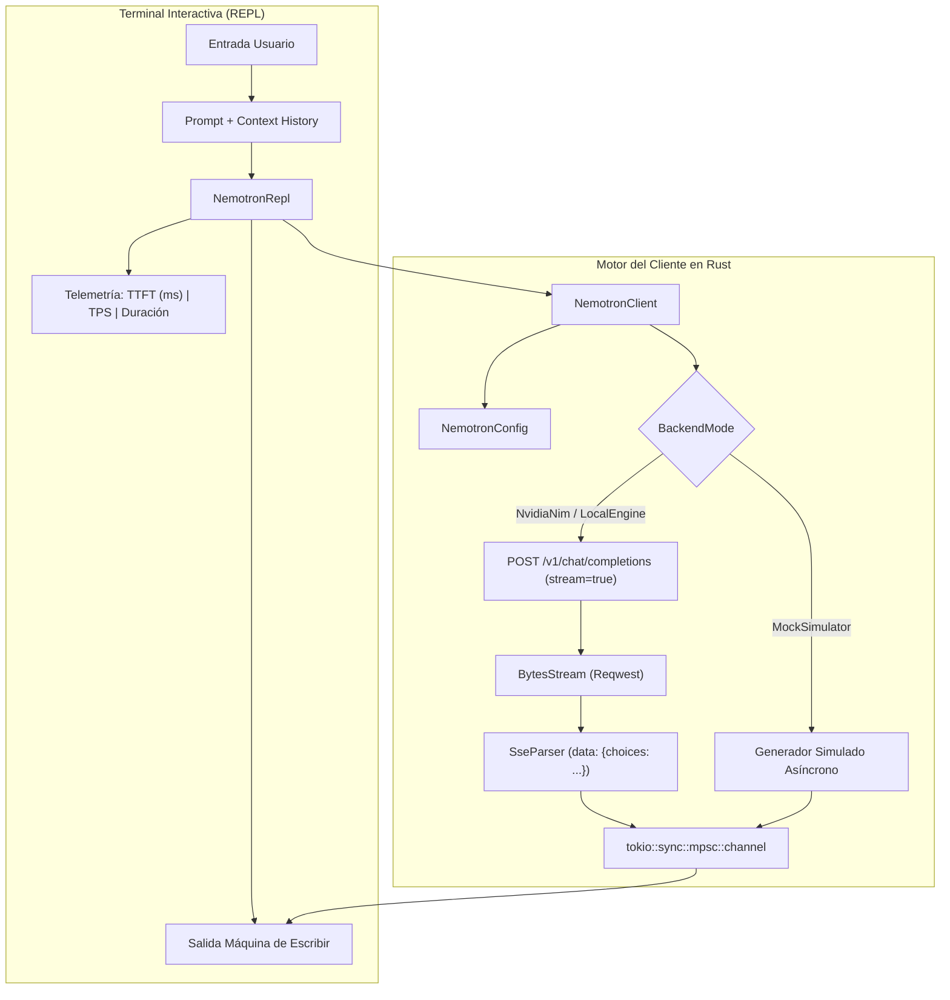

# Arquitectura del Proyecto 02a: Cliente Interactivo & Streaming SSE para NVIDIA Nemotron

> **Módulo:** Fase 5 — Proyecto 02a (Extensión de LLM Serving & Streaming)  
> **Objetivo:** Implementar un cliente de alto rendimiento en Rust para dialogar con modelos de la familia **NVIDIA Nemotron** (`llama-3.1-nemotron-70b-instruct`, `nemotron-4-340b`, `nemotron-mini-4b`) mediante streaming de eventos Server-Sent Events (SSE), telemetría de latencia (TTFT/TPS) y soporte híbrido Nube/Local/Simulador.

---

## 1. Diagrama de Arquitectura del Sistema



---

## 2. Componentes Principales

### A. Tipos de Datos y Protocolo (`src/types.rs`)
Implementa las estructuras de datos de la especificación de OpenAI adoptada por NVIDIA NIM:
* `ChatMessage`: Mensajes etiquetados con roles tipados en Rust (`Role::System`, `Role::User`, `Role::Assistant`).
* `ChatCompletionRequest`: Carga útil JSON con temperatura, top_p, max_tokens y flag `stream: true`.
* `ChatCompletionChunk`: Estructura delta para deserializar fragmentos de texto transmitidos por SSE.

### B. Parser Server-Sent Events Zero-Copy (`src/sse.rs`)
La API de NVIDIA emite tokens a través de un stream continuo HTTP con formato SSE:
```text
data: {"id":"chat-123","choices":[{"delta":{"content":"Hola"}}]}
data: {"id":"chat-123","choices":[{"delta":{"content":" mundo"}}]}
data: [DONE]
```
`SseParser::parse_line`:
1. Filtra comentarios SSE (`: keep-alive`) y líneas vacías.
2. Detecta la señal de terminación `data: [DONE]`.
3. Deserializa el JSON únicamente para extraer el string `delta.content`, enviándolo inmediatamente al canal sin retener buffers en memoria.

### C. Telemetría de Inferencia en Tiempo Real (`src/metrics.rs`)
Calcula con precisión de microsegundos:
* **TTFT (Time To First Token):** $t_{\text{primer token}} - t_{\text{envío}}$, indicando la latencia de inicialización del modelo.
* **TPS (Tokens Per Second):** $\frac{\text{total tokens}}{\text{duración total}}$, midiendo el rendimiento de generación del hardware.

### D. Consola Interactiva REPL (`src/repl.rs`)
Mantiene el contexto conversacional en un vector en memoria y ofrece comandos de control:
* `/help`: Muestra la guía de comandos.
* `/clear`: Reinicia la memoria y restaura las directivas del sistema.
* `/model <nombre>`: Cambia el modelo en caliente (ej. `nvidia/nemotron-4-340b-instruct`).
* `/system <instrucciones>`: Modifica la personalidad o especialización del asistente.
* `/config`: Muestra los parámetros de conexión actuales.
* `/exit`: Finaliza la sesión.

---

## 3. Modos de Ejecución

1. **Modo Simulador Offline (por defecto sin API Key):**
   Permite compilar y experimentar inmediatamente con la consola interactiva, el streaming de tokens y la telemetría de latencia sin conexión externa.
   ```bash
   cargo run --release -p proyecto_02a_nemotron_client
   ```

2. **Modo NVIDIA NIM Cloud (Modelo 70B/340B real):**
   Obtén una clave gratuita en [build.nvidia.com](https://build.nvidia.com) y pásala por variable de entorno o argumento:
   ```bash
   export NVIDIA_API_KEY="nvapi-..."
   cargo run --release -p proyecto_02a_nemotron_client
   ```
   O directamente:
   ```bash
   cargo run --release -p proyecto_02a_nemotron_client -- nvapi-...
   ```

3. **Modo Motor Local (Ollama / vLLM / llama.cpp):**
   Conéctate a cualquier motor local compatible apuntando la URL base:
   ```rust
   let config = NemotronConfig::for_local_engine("http://localhost:11434/v1", "nemotron-mini");
   ```
