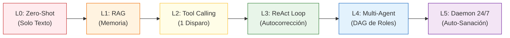

# Laboratorio de Agenticidad: Del Prompt Cero al Enjambre Autónomo

> **Módulo:** Fase 5 — Proyecto Final  
> **Crate Raíz:** `proyecto_05_agenticidad`  
> **Objetivo:** Explorar y medir experimentalmente los **grados de autonomía en la IA Agéntica**, evaluando cada nivel contra un mismo microservicio roto en [`sandbox/broken_service`](sandbox/broken_service/).

---

## 1. El Desafío Común de Evaluación

Para comparar científicamente el comportamiento y la autonomía de cada nivel, todos los agentes se enfrentan al mismo problema en [`sandbox/broken_service/src/main.rs`](sandbox/broken_service/src/main.rs):

```rust
//! Microservicio con error intencional para evaluar grados de agenticidad.
pub fn calculate_tax(amount: f64) -> String {
    // ERROR E0308: expected `String`, found `f64`
    amount * 0.18
}

fn main() {
    let tax = calculate_tax(100.0);
    println!("Impuesto: {}", tax);
}

#[cfg(test)]
mod tests {
    use super::*;

    #[test]
    fn test_calculate_tax() {
        assert_eq!(calculate_tax(100.0), "18.00");
    }
}
```

---

## 2. Los 6 Niveles del Espectro Agéntico



| Nivel | Subproyecto | Autonomía | Percepción | Actuadores | Bucle Retroalimentación | Tasa Éxito |
| :---: | :--- | :---: | :---: | :---: | :---: | :---: |
| **0** | [`nivel_0_zero_shot`](nivel_0_zero_shot/) | **0%** | Nula | Ninguno | Ninguno | **0.0%** (Alucina Python) |
| **1** | [`nivel_1_augmented_rag`](nivel_1_augmented_rag/) | **10%** | Código + Docs `rustc` | Ninguno | Ninguno | **0.0%** (No modifica disco) |
| **2** | [`nivel_2_tool_caller`](nivel_2_tool_caller/) | **35%** | Esquemas de Tools | `write_file` (1 tiro) | Ninguno | **Frágil / 0%** (Falla de escape fatal) |
| **3** | [`nivel_3_react_loop`](nivel_3_react_loop/) | **70%** | `read_file` + `cargo check` | `write_file` + `cargo test` | **ReAct Cerrado** | **100.0%** (Autocorrección verificada) |
| **4** | [`nivel_4_multi_agent`](nivel_4_multi_agent/) | **85%** | Roles especializados | DAG de Tareas + RBAC | Supervisor + Mini-Loops | **100.0%** (Aprobado por Auditor) |
| **5** | `nivel_5_autonomous_daemon` *(Próximo)* | **99%** | Watcher de Sistema | Daemon tokio select! | Always-On 24/7 | En diseño |

---

## 3. Resumen de Hallazgos por Nivel

### Nivel 0: Zero-Shot Passive LLM ([`nivel_0_zero_shot`](nivel_0_zero_shot/))
* **Comportamiento:** Al pedirle corregir el microservicio sin contexto, Nemotron alucina una función en Python: `def calculate_tax(amount): return f"{amount * 0.18:.2f}"`.
* **Lección:** El modelo no sabe qué lenguaje se usa ni qué archivos existen en el repositorio.

### Nivel 1: Augmented RAG ([`nivel_1_augmented_rag`](nivel_1_augmented_rag/))
* **Comportamiento:** El retriever inyecta el código de `main.rs` y la documentación del error `rustc E0308`. Nemotron genera código Rust perfecto (`format!("{:.2}", amount * 0.18)`), eliminando toda alucinación.
* **Lección:** RAG resuelve el problema del conocimiento (*epistemológico*), pero tiene **0% de capacidad de actuar en el mundo físico**: el microservicio en disco continúa 100% roto.

### Nivel 2: Single-Shot Tool Caller ([`nivel_2_tool_caller`](nivel_2_tool_caller/))
* **Comportamiento:** Se le proporcionan herramientas para modificar archivos (`write_file`). Por primera vez, el modelo altera el disco real.
* **Lección:** Al operar en "un solo disparo a ciegas", un carácter no escapado en el JSON genera `error[E0748]: unterminated raw string` y el agente fracasa catastróficamente al no tener oportunidad de reintentar.

### Nivel 3: Bucle Autónomo ReAct ([`nivel_3_react_loop`](nivel_3_react_loop/))
* **Comportamiento:** Bucle iterativo de 5 pasos: lee el archivo $\rightarrow$ corre `cargo check` $\rightarrow$ recibe `error[E0308]` $\rightarrow$ aplica el parche $\rightarrow$ comprueba compilación $\rightarrow$ ejecuta `cargo test`.
* **Lección:** **El verdadero umbral de la agenticidad.** El agente no depende de la suerte; prueba, observa el error del compilador, se autocorrige y persiste hasta que las pruebas unitarias pasan en disco.

---

## 4. Guía Rápida de Comandos

```bash
# Nivel 0 (Zero-Shot)
cargo run --manifest-path fase-5-proyecto-final/Cargo.toml --release -p nivel_0_zero_shot

# Nivel 1 (Augmented RAG)
cargo run --manifest-path fase-5-proyecto-final/Cargo.toml --release -p nivel_1_augmented_rag

# Nivel 2 (Single-Shot Tool Caller)
cargo run --manifest-path fase-5-proyecto-final/Cargo.toml --release -p nivel_2_tool_caller

# Nivel 3 (ReAct Loop con Nemotron)
NVIDIA_API_KEY="tu_api_key" cargo run --manifest-path fase-5-proyecto-final/Cargo.toml --release -p nivel_3_react_loop

# Ejecutar el microservicio reparado por Nivel 3
cargo run --manifest-path fase-5-proyecto-final/proyecto_05_agenticidad/sandbox/broken_service/Cargo.toml
```
