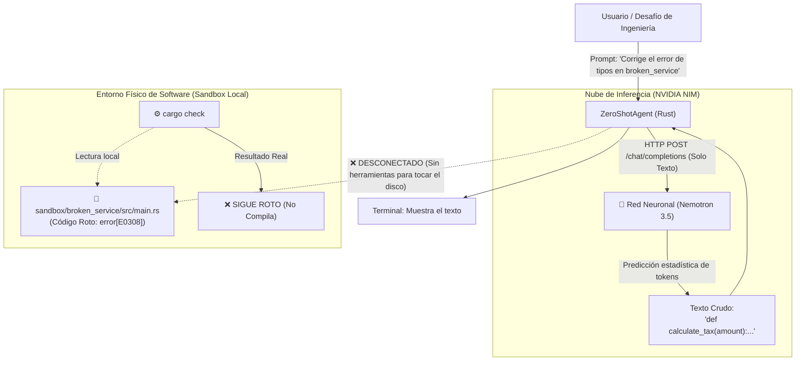

# Arquitectura del Nivel 0: El LLM Pasivo (Zero-Shot)

> **Módulo:** Fase 5 — `proyecto_05_agenticidad`  
> **Subproyecto:** `nivel_0_zero_shot`  
> **Grado de Autonomía:** **0% (Nivel 0 / L0 — Cero Agenticidad)**  
> **Estado:** Implementado, Verificado y Documentado

---

## 1. Definición Teórica del Nivel 0

El **Nivel 0 (Zero-Shot / Generación Directa)** representa el estado más elemental de la interacción con un Modelo de Lenguaje (LLM). 

En este nivel:
1. **Flujo Lineal Estático:** La interacción se limita a una función pura:
   $$\text{Salida} = f_{\text{LLM}}(\text{Prompt})$$
   No existen ramas condicionales, llamadas a APIs externas ni bucles de reintento.
2. **Aislamiento Cognitivo (*Brain-in-a-vat*):** El modelo no tiene acceso sensorial al entorno de ejecución (no puede leer directorios, examinar archivos ni consultar el sistema operativo).
3. **Cero Capacidad de Acción (*No Actuators*):** Carece de permisos o herramientas para alterar el estado de la máquina local.

---

## 2. Diagrama de Arquitectura

El siguiente diagrama ilustra la **desconexión estructural** entre la red neuronal y el entorno físico del software:



---

## 3. Componentes del Código en Rust

El subproyecto se organiza en dos módulos principales:

### A. Motor de Consulta Pasiva (`src/lib.rs` - `ZeroShotAgent`)
* Conexión asíncrona mediante `reqwest` a la API de **NVIDIA NIM** (`https://integrate.api.nvidia.com/v1/chat/completions`).
* Envío de un payload JSON elemental con roles `system` y `user`.
* No registra ningún `tools` ni esquemas de función (*Function Calling*).
* Modo fallback simulado en caso de ausencia de clave de red.

### B. Evaluador del Entorno (`verify_sandbox`)
* Invoca mediante `std::process::Command` el proceso `cargo check` dentro de la carpeta `sandbox/broken_service`.
* Captura el código de salida (*exit code*) y los mensajes en `stderr`.
* Determina objetivamente si la intervención de la IA tuvo algún impacto en el software real.

---

## 4. Resultados del Experimento en Vivo

Sometimos a `nivel_0_zero_shot` al siguiente desafío:

> *"El microservicio en sandbox/broken_service no compila debido a un error de tipos. Corrige la función calculate_tax para que devuelva un String formateado a 2 decimales y pase cargo test."*

### Telemetría y Hallazgos Registrados:

| Parámetro | Valor Medido | Observación |
| :--- | :--- | :--- |
| **Tiempo de respuesta (TTFT)** | ~600 ms | Rápido (inferencia remota en GPU). |
| **Herramientas invocadas** | **0** | No tiene actuadores disponibles. |
| **Archivos leídos del disco** | **0** | No sabe qué hay en `src/main.rs`. |
| **Archivos modificados** | **0** | Cero escrituras en el sistema de archivos. |
| **Respuesta generada** | `def calculate_tax(amount): ...` | **Alucinación de Python**: al no poder inspeccionar el proyecto, predijo el lenguaje más común de su corpus. |
| **Estado final del Sandbox** | `error[E0308]: mismatched types` | **El microservicio sigue roto**. |
| **Tasa de Resolución Autónoma** | **0.0% (Fracaso Total)** | Incapaz de resolver el problema de ingeniería. |

---

## 5. Matriz de Brechas hacia la Agenticidad

Para que este sistema pueda resolver el problema, necesita adquirir progresivamente las capacidades de los siguientes niveles:

```
[ Nivel 0: Zero-Shot ]      <-- ESTAMOS AQUÍ (Solo texto pasivo)
        │
        ▼ (+ Memoria semántica e indexación de archivos)
[ Nivel 1: RAG Aumentado ]
        │
        ▼ (+ Herramientas de lectura/ejecución puntual)
[ Nivel 2: Tool Caller ]
        │
        ▼ (+ Bucle de auto-corrección ReAct)
[ Nivel 3: ReAct Loop ]     <-- PRIMER NIVEL CAPAZ DE REPARAR EL CÓDIGO
        │
        ▼ (+ División del trabajo y supervisores)
[ Nivel 4: Multi-Agente ]
        │
        ▼ (+ Operación autónoma en segundo plano 24/7)
[ Nivel 5: Demonio Continuo ]
```

---

## 6. Conclusión de Ingeniería

El Nivel 0 demuestra que **la inteligencia bruta de un modelo no equivale a capacidad de acción**. Un LLM de última generación como Nemotron, sin herramientas ni bucle agéntico, es un consejero ciego: puede emitir respuestas superficialmente plausibles, pero es estructuralmente incapaz de verificar la realidad o modificar el software.
