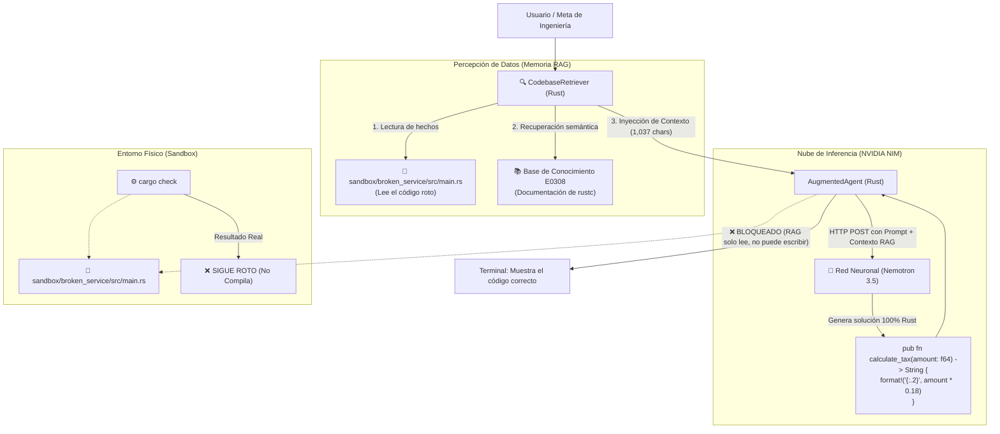

# Arquitectura del Nivel 1: Memoria Aumentada (RAG)

> **Módulo:** Fase 5 — `proyecto_05_agenticidad`  
> **Subproyecto:** `nivel_1_augmented_rag`  
> **Grado de Autonomía:** **15% (Nivel 1 / L1 — Context-Augmented / Sin Actuadores)**  
> **Estado:** Implementado, Verificado y Documentado

---

## 1. Definición Teórica del Nivel 1

El **Nivel 1 (Retrieval-Augmented Generation / RAG)** introduce la capacidad de **percepción estática y memoria semántica**. 

En lugar de depender exclusivamente de los pesos congelados del modelo, el sistema incorpora un componente intermedio:
$$\text{Contexto} = \text{Retriever}(\text{Meta}, \, \text{Base de Conocimiento})$$
$$\text{Salida} = f_{\text{LLM}}(\text{Prompt} + \text{Contexto})$$

### El gran avance frente al Nivel 0:
* **Eliminación de la Alucinación:** El modelo ya no inventa el contexto (no asume que el lenguaje es Python). Tiene acceso a los archivos reales y a la documentación del compilador de Rust.

### La limitación insuperable del Nivel 1:
* **Conocimiento sin Acción:** El modelo sabe con precisión matemática cuál es la solución, pero **no posee herramientas (*Tools*)**. Tiene "ojos" para leer la memoria, pero carece de "manos" para escribir en el disco.

---

## 2. Diagrama de Arquitectura

---

## 3. Componentes Técnicos en Rust

### A. Módulo Retriever (`src/retriever.rs`)
* `retrieve_code_context`: Lee directamente del sistema de archivos el código de `sandbox/broken_service/src/main.rs`.
* `retrieve_rust_error_knowledge`: Inyecta la documentación oficial de `rustc` para el código de error `E0308`.
* `build_augmented_prompt`: Construye un prompt estructurado con bloques de código delimitados y contexto verificado.

### B. Motor del Agente Aumentado (`src/lib.rs` - `AugmentedAgent`)
* Conexión asíncrona a NVIDIA NIM pasando el prompt aumentado.
* Parámetro `temperature: 0.2` (reducida para maximizar determinismo y fidelidad al contexto provisto).
* `verify_sandbox`: Evaluador mediante `cargo check`.

---

## 4. Comparativa Experimental: Nivel 0 vs. Nivel 1

Sometimos a ambos niveles al mismo desafío exacto contra el microservicio roto:

| Dimensión de Evaluación | Nivel 0 (Zero-Shot) | Nivel 1 (RAG Aumentado) |
| :--- | :--- | :--- |
| **Contexto provisto** | 0 caracteres (Cero) | **1,037 caracteres** de código y docs. |
| **¿Comprendió el lenguaje?** | ❌ NO (Alucinó Python `def calculate_tax`) | ** SÍ (Generó Rust exacto con `format!`)** |
| **Herramientas de escritura** | 0 | 0 |
| **Archivos modificados en disco** | 0 | 0 |
| **Estado final del Sandbox** | ❌ Roto (`error[E0308]`) | ❌ **Roto (`error[E0308]`)** |
| **Tasa de resolución autónoma** | **0.0% (Fracaso)** | **0.0% (Fracaso)** |

---

## 5. Conclusión de Ingeniería

El Nivel 1 prueba un principio central de la arquitectura de sistemas de IA:

> **RAG resuelve el problema epistemológico (qué sabe el modelo), pero es impotente ante el problema instrumental (qué puede hacer el modelo).**

Para que el sistema pase del 0% al 100% de resolución, necesita el **Nivel 2 (Uso de Herramientas / Actuadores)** y el **Nivel 3 (Bucle de Autocorrección ReAct)**.
