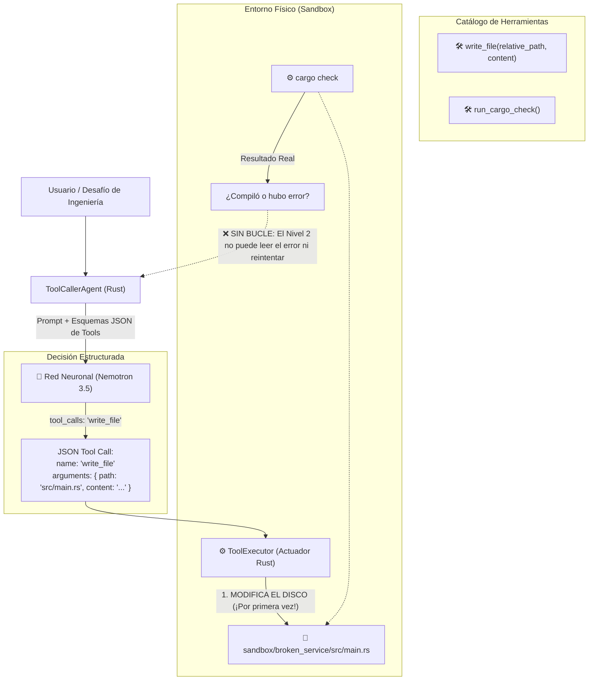

# Arquitectura del Nivel 2: Uso Guiado de Herramientas (Tool Calling)

> **Módulo:** Fase 5 — `proyecto_05_agenticidad`  
> **Subproyecto:** `nivel_2_tool_caller`  
> **Grado de Autonomía:** **35% (Nivel 2 / L2 — Tool Use / Disparo Único)**  
> **Estado:** Implementado, Verificado y Documentado

---

## 1. Definición Teórica del Nivel 2

El **Nivel 2 (Tool Use / Function Calling)** introduce el primer contacto de la red neuronal con el mundo físico: **los actuadores (herramientas)**.

A diferencia del Nivel 0 (que solo genera texto) y del Nivel 1 (que solo lee texto vía RAG):
$$\text{Acción} = f_{\text{LLM}}(\text{Meta}, \, \text{Esquemas de Herramientas})$$
$$\text{Efecto} = \text{Ejecutor}(\text{Acción})$$

### El gran avance frente a los Niveles 0 y 1:
* **El modelo adquiere "manos":** Ya no se limita a sugerir código en la pantalla. Genera una orden estructurada en JSON (`tool_calls`) que el runtime en Rust interpreta para **modificar archivos en disco o ejecutar comandos del sistema operativo**.

### La vulnerabilidad estructural del Nivel 2 (Por qué NO es Nivel 3):
* **Disparo Único (*Single-Shot Execution*):** El Nivel 2 carece de bucle de retroalimentación (`while`). 
* El modelo dispara una sola acción. Si el parche tiene un error de sintaxis, falta un punto y coma o no compila, el agente **no puede observar el fallo, no puede reflexionar y no puede corregirse**. Se detiene inmediatamente.

---

## 2. Diagrama de Arquitectura

---

## 3. Componentes Técnicos en Rust

### A. Ejecutor de Herramientas (`src/tools.rs` - `ToolExecutor`)
* `get_tools_schema`: Define los esquemas JSON compatibles con la especificación OpenAI/NIM.
* `execute_tool`: Deserializa de forma segura los argumentos con alias flexibles (`path`, `relative_path`, `content`, `code`) y ejecuta la operación en el sistema de archivos.
* `reset_broken_service`: Función de saneamiento que restaura el microservicio a su estado roto original para garantizar pruebas reproducibles.

### B. Agente de Disparo Único (`src/lib.rs` - `ToolCallerAgent`)
* Conexión asíncrona pasando `tools` y `tool_choice: "auto"`.
* Recepción de `tool_calls`.
* Ejecución **estrictamente de 1 solo paso** (sin bucles de reintento).
* Verificación física final mediante `cargo check` y `cargo test`.

---

## 4. Evidencia Experimental en Vivo

Durante la prueba en vivo contra Nemotron 3.5 en los servidores de NVIDIA, observamos el fenómeno exacto que define al Nivel 2:

1. **El modelo decidió invocar la herramienta:**  
   `Herramienta ejecutada: 'write_file' en 'src/main.rs'`
2. **El disco fue modificado:**  
   `Archivo 'src/main.rs' escrito con éxito (96 bytes)`
3. **El error de disparo único:**  
   Al escapar las comillas en el JSON, el modelo introdujo un error tipográfico (`unterminated raw string`).
4. **El resultado:**  
   Como el Nivel 2 no tiene bucle ReAct, **se detuvo y el servicio continuó roto**. No pudo leer el mensaje de error del compilador para arreglar su propio fallo.

---

## 5. Cuadro Comparativo de la Escalera de Agenticidad

| Dimensión | Nivel 0 (Zero-Shot) | Nivel 1 (RAG) | Nivel 2 (Tool Calling) |
| :--- | :--- | :--- | :--- |
| **Percepción** | Cero | Memoria RAG | Esquemas de funciones |
| **Actuadores (Manos)** | ❌ Cero | ❌ Cero | ** SÍ (Escribe en disco)** |
| **Archivos modificados** | 0 | 0 | **1 archivo modificado** |
| **Bucle de retroalimentación** | ❌ Ninguno | ❌ Ninguno | ❌ **Ninguno (1 solo paso)** |
| **Resiliencia ante errores** | Nula | Nula | **Frágil (si falla el disparo, muere)** |

---

## 6. Conclusión de Ingeniería

El Nivel 2 demuestra que **darle herramientas a un modelo no es suficiente para alcanzar autonomía real**. 

Un sistema de Nivel 2 es un "disparo a ciegas": puede apretar el gatillo, pero no puede ver dónde cayó la bala ni corregir la puntería. Para resolver problemas de ingeniería en producción, es obligatorio ascender al **Nivel 3 (ReAct Loop: Bucle Autónomo de Raciocinio, Acción, Observación y Autocorrección)**.
