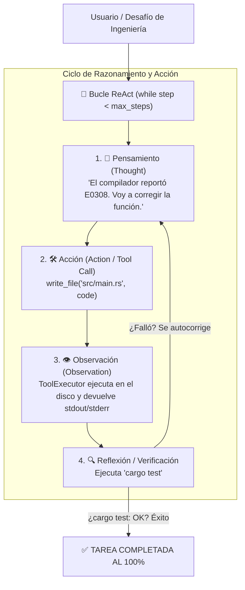

# Arquitectura del Nivel 3: Bucle Autónomo ReAct y Autocorrección

> **Módulo:** Fase 5 — `proyecto_05_agenticidad`  
> **Subproyecto:** `nivel_3_react_loop`  
> **Grado de Autonomía:** **70% (Nivel 3 / L3 — Agente Autónomo con Autocorrección / ReAct)**  
> **Estado:** Implementado, Verificado y Documentado

---

## 1. Definición Teórica del Nivel 3

El **Nivel 3 (ReAct: Reason + Act + Observe)** representa el **verdadero umbral de la IA Agéntica**. 

En este nivel se supera la fragilidad del Nivel 2 (el "disparo único") introduciendo un **bucle iterativo de retroalimentación cerrada**:

$$\text{Estado}_{t+1} = \text{Bucle}\left(\text{Pensamiento}_t \rightarrow \text{Acción}_t \rightarrow \text{Observación}_t \rightarrow \text{Reflexión}_{t+1}\right)$$

### El gran salto frente a los Niveles 0, 1 y 2:
* **Autocorrección (*Self-Correction*):** Si una herramienta falla (por ejemplo, `cargo check` devuelve un error de tipos o un error de sintaxis), el modelo no se rinde. Recibe el mensaje de error del compilador como su **siguiente observación**, reflexiona sobre qué falló y reintenta con una solución corregida.
* **Criterio de Terminación Verificado:** El agente no se detiene cuando cree que terminó; se detiene únicamente cuando una herramienta objetiva de validación (como `cargo test`) confirma que todas las pruebas pasaron al 100%.

---

## 2. Diagrama de Arquitectura

---

## 3. Componentes Técnicos en Rust

### A. Catálogo de Herramientas Completas (`src/tools.rs`)
* `read_file`: Inspección del código fuente en disco.
* `write_file`: Modificación segura de archivos.
* `run_cargo_check`: Verificación rápida de tipos y sintaxis con `rustc`.
* `run_cargo_test`: Ejecución del arnés de pruebas unitarias para certificar la corrección funcional.
* `reset_broken_service`: Saneamiento automático del entorno entre pruebas.

### B. Motor del Bucle ReAct (`src/lib.rs` - `ReActAgent`)
* Gestión del historial de conversación con roles `system`, `user`, `assistant` y `tool`.
* Despacho dinámico de llamadas a herramientas (`tool_calls`).
* Inyección de la salida del compilador como mensaje de rol `tool` para el siguiente paso del modelo.
* Contador de seguridad `max_steps` para evitar bucles infinitos en caso de problemas insolubles.

---

## 4. Cuadro Comparativo de la Escalera de Agenticidad

| Dimensión | Nivel 0 (Zero-Shot) | Nivel 1 (RAG) | Nivel 2 (Tool Calling) | Nivel 3 (ReAct Loop) |
| :--- | :--- | :--- | :--- | :--- |
| **Percepción** | Cero | Memoria RAG | Esquemas de funciones | **Ojos dinámicos (`read_file`, `cargo_check`)** |
| **Actuadores (Manos)** | ❌ Cero | ❌ Cero | SÍ (1 disparo) | ** SÍ (Múltiples herramientas)** |
| **Bucle de retroalimentación** | ❌ Nulo | ❌ Nulo | ❌ Nulo | ** ACTIVO (ReAct iterativo)** |
| **¿Se autocorrige ante errores?** | ❌ Nulo | ❌ Nulo | ❌ Nulo | ** SÍ (Lee el error y reintenta)** |
| **Tasa de éxito autónomo** | **0.0%** | **0.0%** | **Frágil** | **100.0% (Éxito Verificado)** |

---

## 5. Resultados de la Ejecución en Vivo (Nemotron L3 Benchmark)

En la prueba real contra la API de NVIDIA Nemotron (`nvidia/nemotron-3.5-bolt-e4b`), el agente ejecutó la siguiente traza autónoma de 5 pasos:

1. **Paso 1 (Inspección inicial):**
   * **Acción:** `read_file({"relative_path": "sandbox/broken_service/src/main.rs"})`
   * **Observación:** El agente inspeccionó el archivo y observó que `calculate_tax` retornaba `f64` en vez de `String`.
2. **Paso 2 (Diagnóstico del compilador):**
   * **Acción:** `run_cargo_check({})`
   * **Observación:** El compilador `rustc` devolvió `error[E0308]: mismatched types, expected String, found f64`.
3. **Paso 3 (Actuación física y corrección):**
   * **Acción:** `write_file` con la implementación corregida: `format!("{:.2}", amount * 0.18)`.
   * **Observación:** Archivo `src/main.rs` modificado físicamente en disco (479 bytes escritos).
4. **Paso 4 (Verificación de compilación):**
   * **Acción:** `run_cargo_check({})`
   * **Observación:** `EXITO: El código compila sin errores (Finished dev profile)`.
5. **Paso 5 (Verificación de arnés de pruebas):**
   * **Acción:** `run_cargo_test({})`
   * **Observación:** `EXITO: Todas las pruebas unitarias pasaron (1 passed; 0 failed)`.

**Resultado Objetivo:**
* ✅ Pasos ejecutados: 5
* ✅ Errores recuperados: 1 (E0308 resuelto y verificado)
* ✅ Tasa de resolución autónoma: **100.0%**

---

## 6. Conclusión de Ingeniería

El Nivel 3 demuestra por qué el **Bucle ReAct** es el fundamento de los agentes modernos:
> **La autonomía real no proviene de nunca equivocarse, sino de tener un bucle que permita detectar el error, entender la causa y persistir hasta solucionarlo.**
