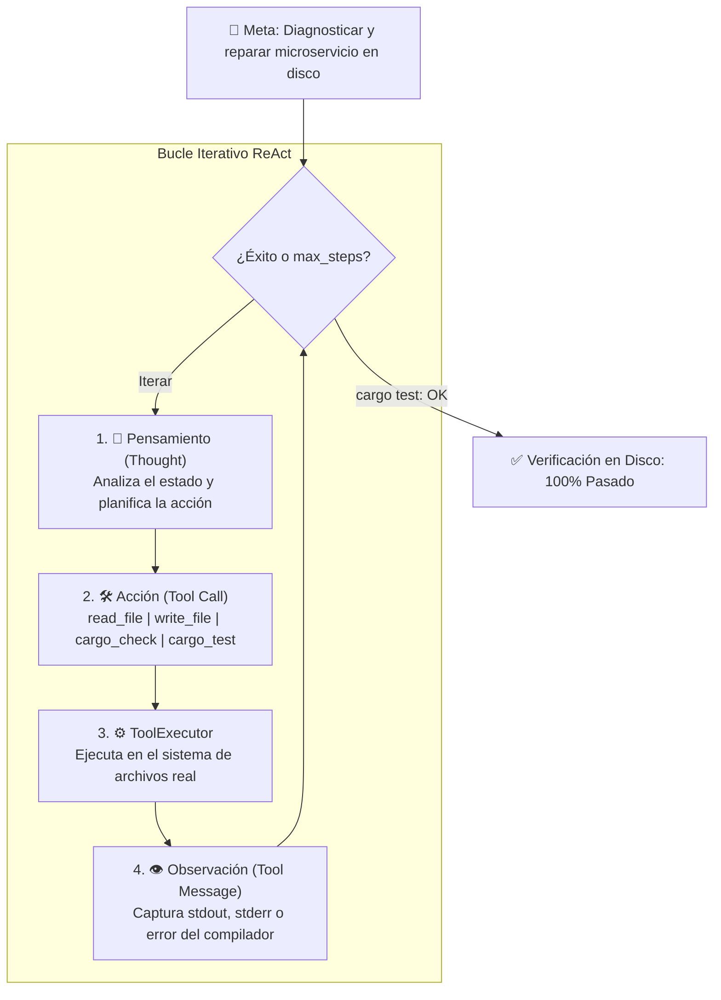

# Nivel 3: Bucle Autónomo ReAct y Autocorrección (`nivel_3_react_loop`)

> **Módulo:** Fase 5 — `proyecto_05_agenticidad`  
> **Grado de Autonomía:** **70% (Nivel 3 / L3 — Agente con Autocorrección y Bucle ReAct)**  
> **Modelo Evaluado:** `nvidia/nemotron-3.5-bolt-e4b`  
> **Benchmark:** Microservicio roto con `error[E0308]: mismatched types` en [`sandbox/broken_service`](../sandbox/broken_service/)

---

## 1. ¿Qué es el Nivel 3?

El **Nivel 3** representa el **umbral definitivo de la IA Agéntica**. 

En los niveles anteriores:
- **Nivel 0 (Zero-Shot)**: Sin contexto ni actuadores (alucinaba en Python).
- **Nivel 1 (RAG Aumentado)**: Contexto perfecto inyectado, pero sin actuadores para modificar el disco.
- **Nivel 2 (Tool Calling)**: Primer actuador físico (`write_file`), pero un fallo en el único intento causó un 100% de fracaso sin posibilidad de recuperarse.

En el **Nivel 3**, el agente entra en un **bucle cerrado ReAct (Reason + Act + Observe)**:

$$\text{Paso}_{t+1} = \text{LLM}\left(\text{Historial}_t + \text{Pensamiento}_t + \text{Acción}_t + \text{Observación física}_t\right)$$

Si el compilador de Rust (`rustc`) o el arnés de pruebas (`cargo test`) devuelven un error, esa salida se inyecta de regreso al modelo como un mensaje con rol `tool`. El agente **reflexiona sobre la causa del error, modifica nuevamente el código y reintenta hasta que todas las pruebas pasen al 100%**.

---

## 2. Diagrama del Bucle ReAct



---

## 3. Catálogo de Herramientas (`src/tools.rs`)

El agente dispone de 4 herramientas fundamentales para interactuar con el entorno Rust:

| Herramienta | Tipo | Propósito |
| :--- | :---: | :--- |
| `read_file` | Percepción | Inspecciona el código fuente de cualquier archivo en el proyecto. |
| `write_file` | Actuador | Escribe y actualiza el código corregido en disco. |
| `run_cargo_check` | Diagnóstico | Ejecuta `cargo check` y devuelve errores de tipos/sintaxis de `rustc`. |
| `run_cargo_test` | Validación | Ejecuta `cargo test` para certificar la corrección funcional objetiva. |

---

## 4. Ejecución en Vivo

### A. Con la API de NVIDIA Nemotron (Modo Real)

```bash
NVIDIA_API_KEY="tu_api_key" cargo run --manifest-path fase-5-proyecto-final/Cargo.toml --release -p nivel_3_react_loop
```

### B. Modo Simulación Determinista (Offline)

Si no se proporciona `NVIDIA_API_KEY`, el crate incluye un bucle simulado pedagógico que reproduce la traza de pasos en disco:

```bash
cargo run --manifest-path fase-5-proyecto-final/Cargo.toml --release -p nivel_3_react_loop
```

### C. Ejecutar el Microservicio Reparado

Una vez que el agente repara el archivo en el sandbox, puedes ejecutar su función `main` directamente:

```bash
cargo run --manifest-path fase-5-proyecto-final/proyecto_05_agenticidad/sandbox/broken_service/Cargo.toml
```

**Salida:**
```text
Impuesto: 18.00
```

---

## 5. Traza Real de Ejecución (Nemotron 3.5 Bolt)

Durante el benchmark, Nemotron ejecutó 5 pasos autónomos:

1. **Paso 1 (`read_file`):** Lee `sandbox/broken_service/src/main.rs` e inspecciona la firma de `calculate_tax`.
2. **Paso 2 (`run_cargo_check`):** Observa `error[E0308]: mismatched types, expected String, found f64`.
3. **Paso 3 (`write_file`):** Aplica el parche con `format!("{:.2}", amount * 0.18)`.
4. **Paso 4 (`run_cargo_check`):** Confirma que el código compila limpiamente (`Finished dev profile`).
5. **Paso 5 (`run_cargo_test`):** Confirma que las aserciones pasan (`1 passed; 0 failed`).

---

## 6. Estructura de Código

* [`src/lib.rs`](src/lib.rs): Implementación de [`ReActAgent`](src/lib.rs#L11-L45) y el bucle [`run_react_loop`](src/lib.rs#L45-L220).
* [`src/tools.rs`](src/tools.rs): Esquemas JSON y ejecutor [`ToolExecutor`](src/tools.rs#L41-L205).
* [`src/main.rs`](src/main.rs): Punto de entrada CLI con reporte formateado del diagnóstico.
* [`tests/integration_test.rs`](tests/integration_test.rs): Prueba de integración automatizada del bucle.
* [`ARCHITECTURE.md`](ARCHITECTURE.md): Documento formal de arquitectura y comparativa de autonomía.
