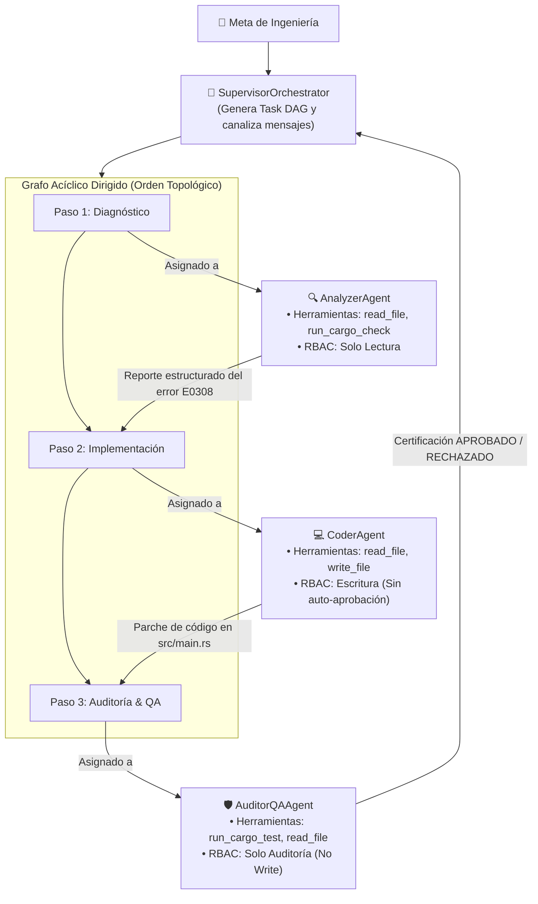

# Arquitectura del Nivel 4: Coordinación Multi-Agente y DAGs de Tareas

> **Módulo:** Fase 5 — `proyecto_05_agenticidad`  
> **Subproyecto:** [`nivel_4_multi_agent`](.)  
> **Grado de Autonomía:** **85% (Nivel 4 / L4 — Sistema Multi-Agente Orquestado con Separación de Roles)**  
> **Estado:** Implementado, Verificado y Documentado

---

## 1. Definición Teórica del Nivel 4

El **Nivel 4 (Multi-Agent Task DAG)** resuelve las dos limitaciones estructurales del Nivel 3 (el agente monolítico):

1. **Saturación Cognitiva (*Context Drift*):** En tareas de ingeniería complejas, el historial de conversación de un único agente acumula diagnósticos, código intermedio, logs de compilación y pruebas, degradando la capacidad de atención del modelo.
2. **Sesgo de Auto-Aprobación (*Self-Grading Bias*):** Un agente programador que corre sus propias pruebas tiende a hacer trampa (por ejemplo, modificando las aserciones de prueba en vez de arreglar el código de negocio) para forzar un resultado exitoso.

### La Solución del Nivel 4:
* **Descomposición en Grafo Acíclico Dirigido (DAG):** El Supervisor planifica las tareas y sus dependencias causales.
* **Separación Estricta de Deberes (Principle of Least Privilege / RBAC):** Cada agente cuenta con un rol específico y un conjunto restringido de herramientas autorizadas. El analista no puede escribir; el programador no puede auto-aprobarse; el auditor independiente certifica la calidad.
* **Mini-Bucles Bounded por Agente:** Cada trabajador en el DAG cuenta con autonomía acotada para inspeccionar y ejecutar su entregable antes de entregar el resultado al siguiente agente.

---

## 2. Diagrama de Arquitectura y Flujo de Trabajo

---

## 3. Matriz de Control de Acceso Basado en Roles (RBAC)

| Rol | Agente | Herramientas Autorizadas | Restricción de Seguridad Aplicada |
| :--- | :--- | :--- | :--- |
| **Orquestador** | `SupervisorOrchestrator` | Gestión de DAG y Mensajería | No interactúa directamente con el disco |
| **Diagnóstico** | `AnalyzerAgent` | `read_file`, `run_cargo_check` | ⛔ **PROHIBIDO:** `write_file` (Acceso read-only) |
| **Desarrollo** | `CoderAgent` | `read_file`, `write_file` | ⛔ **PROHIBIDO:** `run_cargo_test` (Evita sesgo de auto-aprobación) |
| **Calidad** | `AuditorQAAgent` | `read_file`, `run_cargo_test` | ⛔ **PROHIBIDO:** `write_file` (No puede alterar los tests) |

---

## 4. Componentes Técnicos en Rust

* [`src/dag.rs`](src/dag.rs): Motor de Grafo Acíclico Dirigido implementando el algoritmo de Kahn para resolución topológica por lotes y detección de dependencias circulares.
* [`src/agents.rs`](src/agents.rs): Definición de [`AgentRole`](src/agents.rs#L8-L23), system prompts especializados por rol y esquemas de mensajes inter-agente.
* [`src/tools.rs`](src/tools.rs): Ejecutor [`ToolExecutor`](src/tools.rs#L40) con validación RBAC en tiempo de ejecución.
* [`src/lib.rs`](src/lib.rs): Orquestador [`MultiAgentOrchestrator`](src/lib.rs#L30) con soporte para NVIDIA Nemotron y bucle de re-auditoría.
* [`src/main.rs`](src/main.rs): CLI interactivo con reporte formateado del grafo y eventos.

---

## 5. Resultados de la Ejecución en Vivo (Nemotron L4 Benchmark)

En la evaluación contra la API de NVIDIA Nemotron (`nvidia/nemotron-3.5-bolt-e4b`), el sistema multi-agente ejecutó 9 eventos coordinados:

1. **Verificación de Seguridad RBAC:**
   * Intento de Analyzer llamando a `write_file`: ⛔ **RECHAZADO**.
   * Intento de Coder llamando a `run_cargo_test`: ⛔ **RECHAZADO**.
2. **Tarea 1 (`1_diagnose` — `AnalyzerAgent`):**
   * Inspeccionó `src/main.rs`.
   * Ejecutó `run_cargo_check` y extrajo `error[E0308]: mismatched types`.
   * Generó un informe estructurado diagnosticando la causa raíz.
3. **Tarea 2 (`2_code_patch` — `CoderAgent`):**
   * Recibió el informe del Analyzer.
   * Aplicó el parche limpio con `write_file`: `format!("{:.2}", amount * 0.18)` sin alterar las pruebas.
4. **Tarea 3 (`3_audit_test` — `AuditorQAAgent`):**
   * Ejecutó `run_cargo_test` de forma independiente.
   * Observó `test tests::test_calculate_tax ... ok`.
   * Certificó la aprobación de la misión.

**Diagnóstico Final:**
* ✅ Tareas del DAG completadas: 3 de 3.
* ✅ Eventos de coordinación: 9.
* ✅ Cumplimiento de RBAC: 100%.
* ✅ Tasa de resolución y aprobación: **100.0%**.
