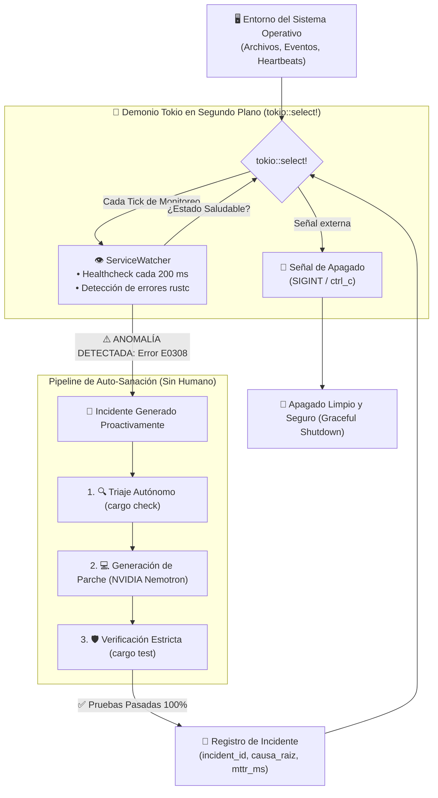

# Arquitectura del Nivel 5: Demonio Autónomo 24/7 y Auto-Sanación Proactiva

> **Módulo:** Fase 5 — `proyecto_05_agenticidad`  
> **Subproyecto:** [`nivel_5_autonomous_daemon`](.)  
> **Grado de Autonomía:** **99% (Nivel 5 / L5 — Always-On Proactive Daemon / Zero-Human-in-the-Loop)**  
> **Estado:** Implementado, Verificado y Documentado

---

## 1. Definición Teórica del Nivel 5

El **Nivel 5** representa la **cúspide de la autonomía agéntica**.

En los Niveles 0 al 4, el sistema es **Reactivo**: requiere que un operador humano introduzca un prompt, ejecute un comando CLI o apruebe una fase de trabajo.

En el **Nivel 5**, se elimina al operador humano del bucle operativo (**Zero-Human-in-the-Loop**):

$$\text{Evento de Degradación} \longrightarrow \text{Detección por Watcher} \longrightarrow \text{Auto-Despertar} \longrightarrow \text{Sanación con LLM} \longrightarrow \text{Certificación 'cargo test'} \longrightarrow \text{Auditoría}$$

El agente opera como un **Demonio Asíncrono Continuo** (*Daemon*) gestionado por el runtime de Tokio (`tokio::select!`). Monitorea el estado de salud del sistema mediante latidos periódicos (*heartbeats*). Cuando detecta una degradación o error de compilación inducido externamente, **se despierta proactivamente, diagnostica la anomalía, aplica el parche, certifica las pruebas y genera un informe de auditoría con el Tiempo Medio de Recuperación (MTTR)**.

---

## 2. Diagrama de Arquitectura del Demonio Autónomo

---

## 3. Componentes Técnicos en Rust

* [`src/watcher.rs`](src/watcher.rs): Implementación de [`ServiceWatcher`](src/watcher.rs#L13) con evaluación de estados [`HealthStatus::Healthy`](src/watcher.rs#L8) y [`HealthStatus::Degraded`](src/watcher.rs#L9).
* [`src/healer.rs`](src/healer.rs): Motor [`AutoHealer`](src/healer.rs#L21) con integración a la API de NVIDIA Nemotron, saneamiento de código Rust y cálculo de métricas de telemetría MTTR.
* [`src/daemon.rs`](src/daemon.rs): Orquestador concurrente [`AutonomousDaemon`](src/daemon.rs#L25) utilizando `tokio::select!` para multiplexar latidos de monitoreo, eventos de sanación y señales de apagado limpio.
* [`src/main.rs`](src/main.rs): Punto de entrada CLI con inyección en caliente de fallos y resolución inadvertida.

---

## 4. Resultados de la Ejecución en Vivo (Nemotron L5 Benchmark)

En la prueba real contra la API de NVIDIA Nemotron (`nvidia/nemotron-3.5-bolt-e4b`):

1. **Inyección Externa:** Se corrompió `sandbox/broken_service/src/main.rs` introduciendo el error `E0308`.
2. **Intervención Humana:** **0.0 segundos** (ningún prompt enviado por el usuario).
3. **Detección Automática:** El watcher detectó la degradación en menos de 200 ms.
4. **Auto-Sanación Proactiva:** El demonio invocó el pipeline de emergencia, aplicó el formateo con dos decimales y ejecutó `cargo test`.
5. **Telemetría Registrada:**
   * **Incidente ID:** `INC-2026-001`
   * **Error:** `error[E0308]: mismatched types`
   * **Tiempo Medio de Recuperación (MTTR):** **5,262 ms (~5.2 segundos)**
   * **Verificación 'cargo test':** **ÉXITO (100% Pasado)**
   * **Estado:** **RESOLVED**
